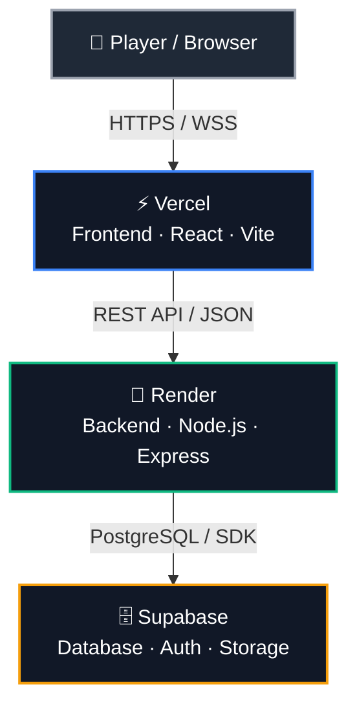

<div align="center">

# 🏰 NPCardGame

### Service Architecture


**Request flow:** `Player` ➜ `Vercel (Frontend)` ➜ `Render (Backend)` ➜ `Supabase (Database)`

</div>

---

## 📑 Table of Contents

1. [Architecture Diagram](#-1-architecture-diagram)
2. [Layer Overview](#-2-layer-overview)
3. [Technical Details and Environment Variables](#-3-technical-details-and-environment-variables)
4. [Operations Note](#-4-operations-note)

---

## 📊 1. Architecture Diagram



---

## 🧱 2. Layer Overview

Vercel and Render each deploy their own directory of the same GitHub repository (shown on the right).

```text
┌──────────────────────────────────────────────┐              ┌──────────────────────────────┐
│                    VERCEL                    │              │       GITHUB REPOSITORY      │
│                (Frontend UI)                 │              ├──────────────────────────────┤
├──────────────────────────────────────────────┤◀── deploys ──│  /frontend                  │
│  • Gacha screen and animations               │              │    React + Vite              │
│  • Local player state management             │              │                              │
└──────────────────────────────────────────────┘              │                              │
                       │                                      │                              │
                       │  (1) HTTP requests / WebSockets      │                              │
                       ▼                                      │                              │
┌──────────────────────────────────────────────┐              │                              │
│                    RENDER                    │              │                              │
│               (Backend Server)               │              │                              │
├──────────────────────────────────────────────┤◀── deploys ──│ 📁 /backend                 │
│  • Game logic and business rules             │              │    Node.js + Express         │
│  • Rate limiting and session validation      │              │                              │
└──────────────────────────────────────────────┘              └──────────────────────────────┘
                       │
                       │  (2) SQL queries and transactions
                       ▼
┌──────────────────────────────────────────────┐
│                  SUPABASE                    │
│             (Database and Auth)              │
├──────────────────────────────────────────────┤
│  • PostgreSQL (cards, inventory, profiles)   │
│  • Supabase Auth and Storage (images)        │
└──────────────────────────────────────────────┘
```

---

## 🔍 3. Technical Details and Environment Variables

| Layer | Hosting | Main Responsibilities | Critical Variables |
| :--- | :---: | :--- | :--- |
| 🎨 **Frontend** | **Vercel** | User interface, fast CDN rendering and real-time interaction. | `VITE_API_URL` |
| ⚙️ **Backend** | **Render** | Service orchestration, gacha rules (UR/LR exclusion, SSR/SR/R drop rates) and security. | `PORT`, `JWT_SECRET`, `SUPABASE_URL` |
| 🗃️ **Database** | **Supabase** | Relational data persistence, user authentication and asset hosting. | `SUPABASE_SERVICE_ROLE_KEY`, `DATABASE_URL` |

> [!WARNING]
> `JWT_SECRET` and `SUPABASE_SERVICE_ROLE_KEY` are secrets. Keep them server-side only and never commit them to the repository or expose them in the frontend (`VITE_*` variables are public).

---

## 📝 4. Operations Note

> [!NOTE]
> The ecosystem is configured to respect traffic (*egress*) limits and to ensure smooth communication between the client hosted on Vercel and the processing server on Render.
